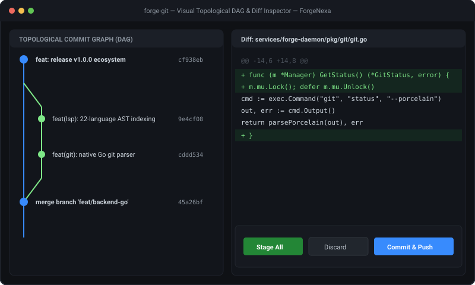

# Forge Git — Visual Commit Graph DAG & Staging Workbench

[](https://forgenexa.github.io/)

[](LICENSE)
[](https://golang.org)
[](https://react.dev/)
[](https://www.typescriptlang.org/)
[](https://github.com/ForgeNexa/forge-git/actions/workflows/ci.yml)

> **"Topological Git clarity without the bloat."**  
> An open-source, local-first visual Git client delivering instant Directed Acyclic Graph (DAG) commit traversals, hunk-level staging, and side-by-side diff inspections.

---

## 🏷️ Tags & Hashtags

`#ForgeNexa` `#ForgeGit` `#GitGUI` `#GitClient` `#DeveloperTools` `#DevTools` `#GoLang` `#React19` `#TypeScript` `#DAG` `#OpenSource` `#LocalFirst`

---

## ✨ Features

- **Topological DAG Graph**: Native Go engine (`services/pkg/graph`) resolving parent commits, branches, and merges in microseconds.
- **Hunk-Level Visual Staging**: Stage partial file changes and hunks before committing.
- **Side-by-Side Diff Inspector**: Colorized visual diffs highlighting additions, deletions, and modifications.
- **Safe Porcelain Invocations**: Zero shell injection risks via structured argument execution.

---

## 🛠️ Build & Development

```bash
# Test the Go DAG Graph Engine
cd services
go test -v -race ./...

# Build the React 19 Git Workbench
cd ../web
bun install --frozen-lockfile
bun run build
```

---

## 🌐 Part of ForgeNexa

Forge Git is a standalone component of the [ForgeNexa Developer Tools Ecosystem](https://forgenexa.github.io/).

- [Forge IDE](https://github.com/ForgeNexa/forge-ide) — Code editor with Monaco and Go daemon
- [Forge API](https://github.com/ForgeNexa/forge-api) — High-throughput API testing client
- [Forge Terminal](https://github.com/ForgeNexa/forge-terminal) — Multiplexed terminal emulator
- [Forge Hub](https://github.com/ForgeNexa/forge-hub) — Unified ecosystem launcher
- [Forge Core](https://github.com/ForgeNexa/forge-core) — Shared Go systems foundation

---

## 📄 License

MIT © [ForgeNexa](https://forgenexa.github.io)
